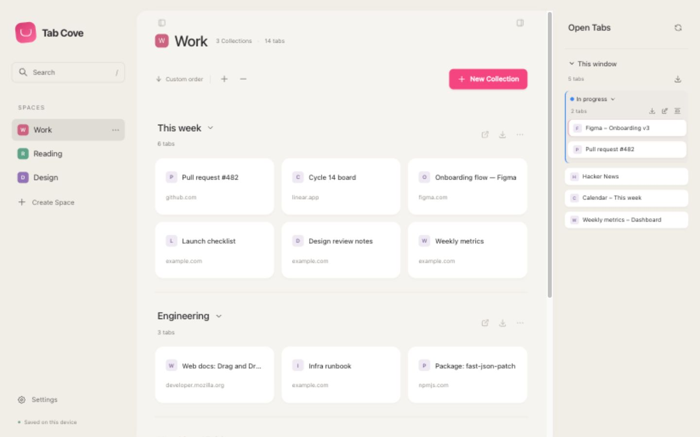

# Tab Cove

基于 WXT、React、TypeScript、Mantine、Zustand 的单机 Chrome 标签工作台。保留独立页面入口，点击扩展图标打开或聚焦工作台，不接管 Chrome 新标签页。



## 首版能力

- 空间、集合与收藏卡片管理；重命名、编辑 URL、移动、排序、合并。
- 浏览器窗口、原生标签组和实时标签目录；聚焦、关闭、移动、组名／颜色／折叠和取消分组。
- 整窗、原生组、单标签保存；保存后保持或关闭；恢复为普通标签或原生组。
- 本地分类搜索，`/` 或 `Ctrl/Cmd + K` 打开；方向键导航，Enter 打开，集合结果可单独跳转。
- 卡片和集合拖拽、跨空间移动、间隙新建集合、实时标签与收藏之间拖拽；菜单提供移动、排序、合并等键盘替代入口。
- 离线 JSON 备份；导入前预览，可追加副本或替换资料库，并选择是否恢复界面偏好。

账号、联网同步、协作、Next、独立笔记、AI、Tags、星标、自定义集合颜色、主题、去重不在首版范围。原生标签组颜色属于已实现范围。

## 构建与加载

使用现有 `pnpm-lock.yaml` 与 pnpm，Node 版本见 `.node-version` 和 `package.json`。已有完整依赖时直接运行：

```sh
pnpm run test
pnpm run compile
pnpm run build
```

在 Chrome 扩展管理页面打开开发者模式，选择“加载已解压的扩展程序”，加载本项目的 `.output/chrome-mv3` 目录。固定 Tab Cove 图标并点击即可进入。更新代码后重新构建，再在扩展管理页点击重新加载。开发使用 `pnpm run dev`。

## 界面语言

支持 English、简体中文和繁體中文。侧栏底部的“语言”菜单可即时切换，选择保存在当前设备；默认跟随浏览器首选语言，未匹配时使用英文。中文按脚本与地区识别，港澳台默认繁体。多个工作台页面会同步语言选择。

界面、搜索、弹窗、操作提示、数量与新会话日期均使用所选语言；已有空间名、集合名、网页标题和网址保持原样。扩展管理页描述、图标提示及首次创建的个人空间名由浏览器语言决定。语言偏好存于 `tabCoveUiPreferences`，不写入资料库文档；存储不可用时切换仍在本次会话生效。

翻译词典位于 `src/i18n/messages.ts`，英文原文作为键，同一条目提供简体与繁体翻译；动态内容使用命名占位符，数量统一通过 `countLabel` 处理。

## 本地数据与会话边界

资料库存于当前浏览器配置文件的 `chrome.storage.local`，键为 `tabCoveLibrary`，不读取或覆盖旧项目账号／团队数据。仅在此键不存在时初始化 `Personal` 空间；损坏或未知版本会报错而不会重置。

保存仅接受 HTTP/HTTPS 页面。右侧目录及会话快照排除所有插件页面，整窗保存另排除固定标签；单独保存固定标签不会关闭它。先成功写入收藏，再复查源标签 URL、待导航 URL、窗口、组及固定状态后关闭。重复 URL 会保留。

恢复保留 URL、顺序和原生组名称／颜色，不恢复网页表单、站点运行状态或历史。部分失败会提示，并在可确定完成状态时仅重试未完成步骤。连接中断后先刷新核对实际结果，再决定是否重复操作。

集合标题下方显示恢复为 Chrome 标签组时使用的颜色。点击可从 Chrome 的九种颜色中指定一种，也可切换为「随机颜色」。随机配色优先使用目标窗口尚未使用的颜色，九种都已占用时从使用次数最少的颜色中随机选。自动选出的颜色只用于本次打开的组。

数据有浏览器容量限制，卸载扩展或清除扩展数据会删除资料库。

## 备份与迁移

在工作台侧栏底部打开「数据管理」，选择「下载备份」。JSON 包含全部空间、集合、收藏、保存和打开偏好，以及主题、明暗模式、语言和侧栏状态；保留顺序、重复网址和原生组颜色。文件不包含实时标签或窗口，也不需要联网。

在目标浏览器中选择该 JSON 文件，核对预览里的资料库和备份数量，再确认：

- **追加副本**（默认）：把备份空间作为新副本加入现有资料库，不按名称或网址合并；目标的保存和打开偏好保持不变。重复追加会再产生一份副本。
- **替换资料库**：用备份覆盖当前收藏及保存和打开偏好，浏览器中已打开的标签页不受影响。建议先导出旧数据；预览后资料库有变化时，需刷新预览并重新确认。
- **恢复界面偏好**默认勾选，两种模式均可关闭。若资料库已导入但界面偏好写入失败，点击「重试恢复偏好」即可，无需再次导入。若连接中断，先刷新核对资料库，再决定是否重试。

仅支持 Tab Cove 自己的版本化备份；文件上限为 11 MiB。符合文件上限也可能超过目标浏览器的可用存储，写入失败时原资料库保持不变。备份协议与异步存储接口分离，可供后续在线适配复用；当前仅支持本机存储，无账号、云端备份或自动同步。

## UI 预览与验证

```sh
pnpm run preview:ui
```

打开终端打印的本地地址。预览复用实际 UI 和领域服务，浏览器目录使用隔离 fixture，收藏写入该预览 origin 的 localStorage；不会操作用户的真实窗口。预览不能用于证明 Chrome API、后台生命周期、离线扩展或拖拽的端到端正确性。测试文件不会打入生产扩展。

当前 63 条 Node 单元测试通过，类型检查和生产构建通过。生产构建存在单个 JavaScript chunk 超过 500 kB 的提示，不影响产物生成。参见 [备份与迁移验证记录](openspec/changes/archive/2026-11-17-add-library-import-export/validation.md) 和 [首版工作台验证记录](openspec/changes/archive/2026-11-17-rebuild-local-tab-workspace/validation.md)。
