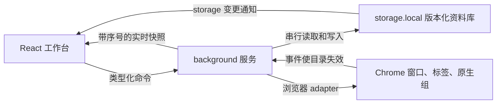

# 技术设计

## 审阅摘要

- 方案：沿用 WXT + React + TypeScript + Mantine + Zustand + Less，将未完成的团队模型替换为本地资料库；浏览器对象通过独立 adapter 操作。
- 关键边界：持久化收藏与实时标签分离；background 是资料库唯一写入方；保存成功后才关闭源标签；浏览器失败不能撤销已保存收藏。
- 兼容约束：保留 `/tabCove.html` 入口与 pnpm 工具链；新 storage 键不覆盖旧数据；首版仅面向桌面 Chrome，不增加后端或运行时依赖。
- 验证：当前 `pnpm run compile` 基线已通过；实施后执行有针对性的 Node 测试、类型检查、Chrome 构建及真实扩展手工回归。实物视觉验收由用户提供可访问基准或人工核对。
- 主要风险：存储与浏览器操作非原子事务、多页面并发、后台休眠、异步目录旧响应、拖拽时源或目标已变化。下文明确处理规则。

## 背景与约束

依据 [research.md](research.md) 的 Q-001 至 Q-008 和三份 delta specs。用户已明确批准按本方案实施；功能完成情况以 tasks 和验证证据为准。

当前服务按 User → Team → Space → Cabinet 组织，Cabinet.urls 复用实时 TabInfo；UI 先要求创建账号，集合仅为按钮列表。新目标不需要身份或权限系统，继续扩展旧模型会让无关约束进入核心流程，因此替换领域模型而保留基础技术。

## 目标与非目标

建立一个本地资料库，其中多个空间容纳集合和链接卡片；Chrome 窗口及原生标签组只代表当前运行状态。没有独立的账号或 Workspace 实体，顶层只显示 Tab Cove 品牌。原生组的颜色属于必要元数据，不引入完整的集合着色与筛选模块。

不实现 Q-008 暂缓能力，不在 UI 保留占位入口；不恢复网站正文、表单、会话 Cookie 或导航历史。点击保存链接仍由 Chrome 正常加载网站，不能把“离线管理”理解为网站离线缓存。

## 当前与目标流程

当前：`App.init → getUser → 创建账号 → Team → Space → Cabinet 名称列表`；旁路为 `WindowCatalog → WC_getWindowInfo → tabs.query`。

目标：

UI 不直接写完整资料库。Zustand 只保存确认后的本地文档、实时快照及瞬时交互状态；搜索结果从这两类数据派生，不另外持久化。

## 修改地图

所有路径相对于项目根；新增文件名用于明确职责，可按相邻代码组织调整，不能改变层次边界。

| 区域 | 已验证路径／符号 | 计划变更 | 依据 |
| --- | --- | --- | --- |
| 模型 | `src/types/core.ts` 的 User/Team/Space/Cabinet | 替换为本地 Space、Collection、SavedTab、LibraryDocument；实时对象仍在浏览器目录模块 | Q-002/Q-003 |
| 存储 | `src/utils/storage/index.ts` 的 storage 项 | 新增 `local:tabCoveLibrary`，版本 1；只暴露读／订阅给 UI，写入限后台服务 | local-persistence |
| 服务 | `src/services/core.ts` | 替换团队 CRUD 为本地命令客户端；新增纯 `libraryModel.ts` 处理关系及顺序、`libraryRepository.ts` 处理串行存储 | 数据关系与并发 |
| 后台 | `src/entrypoints/background/index.ts` | 同步注册入口、资料库消息、浏览器事件，不先 await 初始化 | 后台生命周期 |
| 入口 | `background/modules/iconClickOpenTabCove.ts` | 保留打开／聚焦行为，合并同时到来的点击，防止重复创建 | Q-005 |
| 浏览器目录 | `background/modules/windowCatalog/` | 完整 LiveTab/LiveGroup/LiveWindow、快照序号、事件刷新；query 失败显式返回失败 | browser-tab-operations |
| 浏览器命令 | 新增 `background/modules/tabOperations/` | adapter、保存／关闭／打开／分组编排；可注入假浏览器端口用于测试 | 保存和恢复失败语义 |
| 消息 | `src/types/messaging.ts` | 替换过期 WC 协议为明确的读取、资料库修改、浏览器操作和目录变更消息 | 类型契约 |
| 状态 | `src/store/` | 移除不再使用的 user/teams/cabinets 及其依赖；采用 library/browser/workspace 状态 | 不保留账号前置 |
| 工作台 | `src/entrypoints/tabCove/App.tsx`、`pages/home/` | 重建 Sidebar、CollectionBoard、TabCard、OpenTabs、Search、编辑／确认弹窗和拖拽目标 | Q-001/Q-002/Q-008 |
| 无关旧入口 | `CreateAccountModal`、AddTeamModal、TeamsMenu、旧 Workbench | 删除因本次重建不再使用的业务组件及关联样式 | 只清理由本次替换导致的死代码 |
| 运行配置 | `wxt.config.ts`、`background/modules/keepAlive.ts`、`src/entrypoints/content.ts` | 按实际使用收敛权限；去掉保活心跳和 Google 示例注入 | 本地工作台不需要页面注入 |
| 验证与交付 | `package.json`、新增 `tests/`、`README.md` | 增加 Node 测试脚本及聚焦用例，记录构建、加载和验收步骤；不安装测试库 | 现有 Node 24 / pnpm |

## 接口与契约映射

### 持久化模型

采用嵌套有序数组，降低孤儿引用和排序字段同步成本。一个小型本地资料库不引入数据库或多表事务。

| 实体 | 字段 | 不变量 |
| --- | --- | --- |
| LibraryDocument | `schemaVersion: 1`、`revision: number`、`spaces: Space[]`、`preferences` | 单一 storage 项；成功写入 revision 递增；所有实体 id 全库唯一 |
| Space | `id: string`、`name: string`、`collections: Collection[]` | 数组即手动顺序；名称去除首尾空白后非空；允许同名空间 |
| Collection | `id: string`、`name: string`、`tabs: SavedTab[]`、`groupColor?: ChromeGroupColor` | tabs 数组即恢复顺序；组颜色仅用于已保存原生组及恢复；不持久化 groupId |
| SavedTab | `id: string`、`title: string`、`url: string` | 使用 nanoid；不使用 tabId/windowId；允许重复 URL；不保存浏览器对象全集 |
| preferences | `saveDisposition: 'ask' \| 'keep' \| 'close'`、`restoreMode: 'ask' \| 'tabs' \| 'group'` | 初始均为 ask；用户主动勾选记住选择才改变；必要设置入口可重置 |

没有资料时建立一个空的 `Personal` 空间；允许继续新建、重命名和删除普通空间，包括最后一个空间。删完后显示建立空间的空态，不自动恢复被用户删除的实体。当前空间选择存于页面状态；若对应空间消失，选剩余第一个空间或空态。

模型读取时验证版本、数组、标识唯一性、必要字符串和 URL；读取失败或损坏不能走 fallback 空库覆盖路径。不做隐式“修复”或自动清空。

### 实时模型

`LiveTab` 保存 `id/windowId/index/title/url/pendingUrl/pinned/active/groupId`；`LiveGroup` 保存 `id/windowId/title/color/collapsed`；`LiveWindow` 保存 `id/focused/tabs/groups`。数字标识只在当前浏览器会话中有效；`TAB_GROUP_ID_NONE` 是未分组，不是资料库实体。

首版面向普通、非隐身窗口；所有 `chrome-extension://` 插件页面（含 pendingUrl 正跳转至插件页面的标签）从实时目录、计数及会话快照中排除，使用同一过滤函数。保存和手动 URL 编辑接受 `http:`、`https:`，保留查询串和 fragment，不自动补协议或去重。除上述插件协议外，其他协议的实时标签可显示并激活／关闭，但保存按钮禁用并说明原因；不请求 file URL 或隐身权限。URL 和标题在执行时重新校验，标题缺失时显示 URL。

### 消息与错误

| 消息 | 输入 | 输出／副作用 |
| --- | --- | --- |
| `library:get` | 无 | 已校验 LibraryDocument 或可展示的读取错误 |
| `library:mutate` | 类型化 command：空间／集合／卡片 CRUD、移动、合并、更新必要偏好；目标实体 id 和 `beforeId` 落点 | 串行从最新文档计算并持久化，返回新 revision；不接收 UI 的整库覆盖 |
| `browser:getSnapshot` | 无 | `epoch + sequence + windows`；失败不能冒充空窗口数组 |
| `browser:operate` | focus/close/move/editGroup/ungroup/save/openCollection/openCard 等区分类型的操作 | 返回实际成功结果和失败条目；save 内部调用同一个资料库写入边界 |
| `browser:changed` | epoch/sequence 的新快照或失效通知 | 仅同步实时目录；不写持久化收藏 |

结果统一为 `ok` 判别联合。失败至少区分 `INVALID_INPUT`、`NOT_FOUND`、`STORAGE_READ_FAILED`、`STORAGE_WRITE_FAILED`、`UNSUPPORTED_SCHEMA`、`BROWSER_OPERATION_FAILED`；部分成功携带成功／失败实体列表及失败阶段。不得仅返回 `[]` 或吞掉 Promise rejection。

队列处理每个 mutation 时重新读取最新库并校验目标；目标不存在或落点失效则失败，不自行创建目标。一次操作导致的源删除和目标插入同次写入。队列在前一操作失败后仍能处理后续操作。UI 在 pending 时禁用同一动作重复提交，消息超时不自动重发有副作用命令，先重新读取结果并提示状态待确认。

### 保存、关闭与恢复

1. 操作开始读取指定窗口／组快照，记录待保存 `tabId + URL + windowId + groupId` 和顺序，排除固定标签、所有插件页面和不支持的 URL。单个实时卡片保存可以保存固定标签，但不会执行关闭固定标签。
2. 提示保持／关闭及实际数量；如果不是 ask，仍在入口提示当前保存模式。以用户确认时的快照为保存对象，不把之后新开的标签加入正在执行的保存。
3. 把快照转换为新 SavedTab id；追加目标基于最新资料库。若创建新集合，整窗默认名为当地日期时间，原生组使用组名；匿名组用日期时间名称。原生组颜色存 `groupColor`。
4. 本地写入成功才考虑关闭；逐一重新读取源标签，只关闭 URL、窗口、组关系仍匹配的非固定标签。消失视为已关闭；已导航／移走视为跳过，并告知用户。不得调用 `windows.remove` 代替关闭快照中的标签。
5. 关闭部分失败时只报告关闭问题，不能再次执行保存或回滚收藏；后台重启后不自动重放未完成的关闭。
6. 恢复在发起操作的工作台所在窗口打开，不受随后焦点变化影响；目标窗口已不存在时明确失败，让用户重新发起。按 SavedTab 顺序串行创建，保存成功 ID。
7. 按用户选择保持普通标签或创建原生组。命名使用当前集合名，颜色使用保存的 `groupColor`，普通集合没有组色时使用 Chrome 的灰色。不持久化恢复产生的浏览器 ID。
8. 打开失败时保留已成功页面；若分组或换色失败，告知页面已打开但分组未完成。重试只处理失败阶段或失败条目，不自动重开整个集合。

整窗保存生成一个平面集合，不保存整个窗口内多个组的嵌套拓扑；需要保留特定组名和颜色时使用“保存该组”。此规则对应官方窗口保存与组保存两个独立入口。

### 浏览器同步

注册 tabs 的 created/removed/updated/moved/activated/attached/detached、windows 的 created/removed/focusChanged、tabGroups 的 created/updated/moved/removed。只对相关 updated 字段刷新，合并短时间事件，操作完成后主动刷新一次。

每次后台实例有 epoch，每次查询有递增 sequence；同实例只发布最新完成的有效查询，页面不接受旧序号。新 epoch 时重新取全量快照。页面启动先订阅，再读取快照；页面重新可见时主动刷新，避免后台休眠期间的尾部通知丢失。

不持久化实时浏览器快照，不依赖持续端口或 alarms 保活。监听器在 background 初始化回调同步注册，异步读库放进请求处理函数。

## 状态与交互行为

### 布局和视觉

以 research V1 为布局和视觉基准：左导航约占 20%，中间为弹性内容，右栏约占 20%；实施时以相同视口对照校准，不把宣传图裁切尺寸直接当 CSS 定值。浅暖灰背景、白色圆角卡片、粉色主要按钮、克制阴影和灰色辅助文字。

使用当前 Mantine 提供弹窗、菜单、输入、提示和 focus 管理，Less Modules 实现卡片和三栏。保留 Tab Cove 名称，产品文案以参考的英文为起点；代码注释和工程文档使用中文。没有远程字体、远程图片依赖或 Toby 账号头像。

左栏只保留空间列表、新建和必要偏好；中间保留空间名、计数、新建集合、全部展开折叠和手动排序；右栏显示窗口、组和实时标签。星标、Tags、备注、视图及主题切换等延期控件不展示。

补充视觉基准见 research V3–V7：Open Tabs 使用紧凑白色标签行；原生组以颜色圆点和左侧同色边线区分，组内计数及保存／编辑／取消分组工具独立于窗口工具。图中 AI 和其他延期图标不纳入首版。

保存弹窗按 V4/V5：居中标题和说明、右上关闭、Don't ask again 复选框；底部左侧描边的 Save & Keep Tabs Open、右侧粉色的 Save & Close Tabs。新会话说明显示日期时间名称，追加说明显示目标集合名；原图没有名称输入框，不在保存确认中额外加入命名步骤。保存完成后可通过集合重命名修改日期时间名称。

先验收 1440 × 900 和 1920 × 1080 的桌面布局；1280 × 720 不应出现按钮遮挡或内容不可滚动。较窄窗口允许折叠左右栏以保留主操作，不新增移动端产品设计。

### 拖拽与排序

用原生 HTML Drag and Drop，不新增依赖；payload 只保存判别类型和实体 id，不携带任意外部 HTML 或整份资料库。收藏和实时对象使用不同 payload，分别进入本地命令或浏览器命令。

明确四种目标：卡片前后插入线、集合内空白区、集合间“新建集合”槽、集合标题的合并区。集合排序使用独立手柄，防止合并与排序难以区分。合并前确认，目标属性保留，源卡片追加，源集合删除；不去重。跨空间移动可拖到空间项或用移动菜单，均走同一命令。

拖拽期间只展示局部预览；drop 后校验源和目标仍存在，再提交；写入失败恢复确认状态。Esc、dragend 和无效落点清理预览。拖拽时页面边缘自动滚动，空集合和长列表可接收落点。提供移动菜单和上下移动按钮作为键盘替代。

实时标签拖入收藏使用保存流程；收藏拖回实时区域是打开副本，收藏保留。实时标签在窗口／组间拖动依次调用 tabs.move、tabs.group/ungroup，按真实结果刷新，不能将浏览器操作假设为原子事务。

### 搜索

本地执行去首尾空白、大小写不敏感的子串匹配。空间和集合匹配名称，收藏和实时标签匹配标题及完整 URL；结果带归属和数量。分类只有 All、Spaces、Collections、Tabs、Open tabs。

选择空间切换当前空间；选择集合走恢复流程；收藏结果打开新标签；实时结果聚焦已有标签。不查历史，不含 Tags/Notes/To Links。非输入状态 `/`、Cmd/Ctrl+K 打开搜索，Esc 关闭并恢复焦点；输入法组合事件和文本编辑不触发单键快捷键。

搜索呈现为 V7 的居中浮层：查询输入与 Clear/关闭在顶行，分类在第二行，下面显示结果计数及带类型图标的结果列表。集合结果保留两个不同动作：打开集合链接，或仅跳转到所在空间并定位该集合。上下方向键移动结果选择，Enter 执行默认打开，结果导航状态的右方向键跳转到集合，Tab 在筛选和可操作项之间按逻辑顺序移动；输入框中的光标移动不被结果导航抢占。底部提示与实际可用快捷键一致。

### 加载、空、成功与错误

资料库与浏览器目录分别有 loading/ready/error 状态。任一侧失败不伪装为空。只有资料库成功确认无数据才初始化；浏览器目录失败不阻止已保存卡片的查看。

删除集合／空间时显示受影响卡片数量；确认后级联删除本地所属内容，浏览器不变。单卡移除只针对该 SavedTab id。存储 mutation 完成后再展示持久化成功，浏览器副作用部分失败使用独立反馈。

### 权限与校验

Manifest 使用 `tabs`、`storage`、`tabGroups`、`favicon`。windows API 的使用不要求名为 `windows` 的权限；移除旧 `alarms`、空 Google content script 和无关 host 注入。无需 history、bookmarks、scripting 或网络主机权限。

图标从扩展自己的 `/_favicon/` 资源获取，不将浏览 URL 发送到第三方图标服务；缺失或离线时用本地首字母图标。加载失败不能影响保存。所有 URL 以文本渲染和 URL API 校验，禁止通过 HTML 注入创建卡片。

权限或 API 不可用时以明确错误禁用相关组操作，不把“未获权限”当成“没有组”；普通本地收藏继续可用。

## 决策与替代方案

| 决策 | 采用原因与代价 |
| --- | --- |
| 新本地模型，不复用 User/Team 权限表 | Q-003 无迁移需求，减少无关路径；旧键保留供回退，不做清理迁移 |
| 嵌套文档 + background 单写入队列 | 一次写入即可保持归属和顺序；代价是修改时写整份小型资料库，先以目标数据量测量性能，不预建数据库层 |
| 持久化成功后执行关闭 | 避免数据未保存就关页；存储和浏览器不能原子提交，允许“已保存但部分未关闭”的显式中间结果 |
| 原生拖拽 + 键盘移动入口 | 现有依赖足够；不为尚未验证的交互安装拖拽库，若真实实现证据表明无法达标再评审 |
| 本地存储容量不足时报错 | 首版不额外请求 unlimitedStorage，不承诺无限容量；避免无依据增加权限 |

## 兼容、迁移与回滚

旧存储项不迁移也不删除，新库独立使用 `local:tabCoveLibrary`。撤回代码可回到旧版本，但新库不是旧版本可读取格式；不要把回滚描述成无损双向迁移。升级 schema 必须显式处理，本次仅版本 1。

开发完成后交付构建产物加载路径和手工验收说明；不替用户发布商店、卸载现有 Toby 或提交 Git。没有导出备份功能；卸载或清除扩展数据会失去本地资料，这一点在 README 和必要数据说明中明确。

## 风险与缓解措施

| 风险 | 处理与验证 |
| --- | --- |
| 两页面覆盖 | 后台从最新库处理命令，验证两个页面同时新增都保留 |
| 写入失败或库损坏 | 禁止关闭源页和空库覆盖，校验容量失败与损坏输入 |
| 保存期间导航／移动 | 关闭前复查 snapshot 标识、URL 和归属；变化的源页跳过 |
| 恢复过程部分失败 | 保留收藏和成功标签，显示失败阶段及可针对性重试结果 |
| 组操作时 Chrome 拒绝编辑 | 捕获失败、保持真实状态、不无限重试；待浏览器拖动结束后用户可重试 |
| 后台休眠及旧快照覆盖 | 懒读库、同步注册监听、epoch/sequence、防过时响应与页面激活刷新 |
| 视觉资料不完整 | 实施前核查公开配图；完成公开基准比对后保留用户实物验收；未通过不标记 1:1 完成 |

## 测试策略

1. 纯模型测试：空间／集合／卡片删除级联、ID 唯一、跨集合移动、合并顺序、间隙新建、空白名称和非法 URL、重复 URL 不被擅自删除。
2. Repository 测试：两次并发修改均保留；失败不毒化队列；损坏／未来版本不初始化覆盖；目标已删除不复活。
3. 浏览器编排测试：保存失败零关闭；固定标签过滤；关闭前 URL／窗口／组变化跳过；部分打开和分组失败；保存蓝色组后以新 groupId 恢复；单卡拖入和整窗保存使用相同写入路径。
4. 同步测试：过时快照不覆盖新快照；新 epoch 重建目录；事件刷新包括导航和跨窗口／组变动。
5. 使用现有 Node 24 的测试能力运行 `.mjs` 测试，纯 TypeScript 模块避免 WXT 自动导入和路径别名。若 Node 的 TypeScript 支持不满足现有源码语法，用现有 tsc 编译纯模块到临时目录后测试，不下载新工具。
6. `pnpm run compile`、`pnpm run build`；不运行不存在的 lint 脚本，不用其他包管理器包装验证。测试脚本拟为 `pnpm run test`，实施时添加。
7. 真正加载构建扩展，在两个普通窗口和一个工作台中验证核心闭环；只使用专门创建的测试页面进行关闭测试。手工核对两个工作台并发和 service worker 重启。
8. 视觉回归覆盖空态、常规卡片、多集合长页、搜索、保存确认、组编辑、拖拽落点和错误提示；截图采用统一视口和测试数据。Toby 实物访问仍受限时由用户人工核对，不能用网页模拟预览代替真实 Chrome 行为验收。

## 未解决的 Non-blocking 事项

没有需要实施者自行选择的产品范围问题。公开帮助页未给出的菜单间距、动画时长等视觉数值在实施时按可访问图片校准；这不放宽 Q-007 约定的最终实物验收条件。
